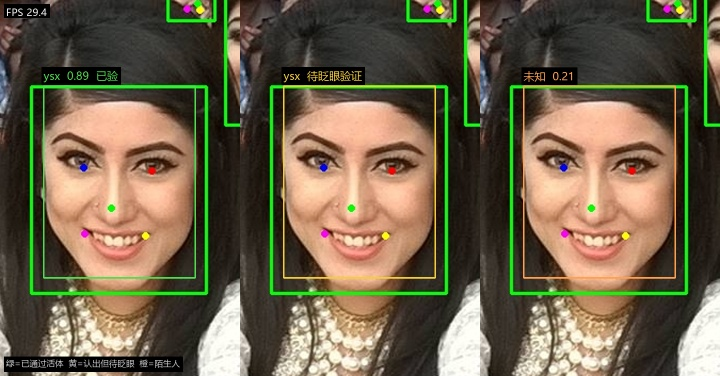
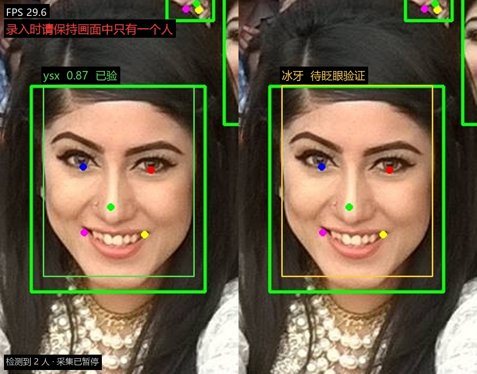

# 摄像头人脸识别 Demo

**Python 3.9+** · **OpenCV 4.5.4+** · **仅需 opencv + numpy** · **MIT License** · 开箱即用，无需下载模型

打开摄像头，实时框出画面里的人脸；把某个人录入之后，它就能叫出名字，不认识的判为「未知」。
带**眨眼活体检测**——认出你之后还要眨一下眼才给结论，拿照片对着镜头骗不过去。
录入时会检查画面里有几个人，出现第二个人就暂停采集并提示。

纯 OpenCV 实现，**不需要 PyTorch / TensorFlow / dlib**，只依赖 `opencv-python` + `numpy`（中文标签额外需要 `pillow`）。

---

## 效果

| 三种识别状态 | 录入时的多人校验 |
|:---:|:---:|
|  |  |
| **绿** = 认出来且已通过眨眼活体<br>**黄** = 认出但还没眨眼（照片会卡在这里）<br>**橙** = 陌生人 / 画质不合格 | 画面出现第二个人立即红字告警，<br>**采集暂停、一帧不采**，人走了自动继续 |

---

## 快速开始

### 方式一：图形界面（推荐，双击就能用）

```
双击 run_gui.bat
```

界面里输入姓名 → 点「采集并添加」→ 正对镜头约 2 秒，自动入库。列表里选中某人可删除，也可以一键清空。
想开门见山检查环境时，命令行跑 `run_gui.bat --check`，它会打印当前选中的解释器和模型状态。

> `gui.py` 需要解释器同时具备 `opencv` 和 `tkinter`。本机实测 `D:\miniconda\python.exe` 满足；
> `D:\python`(3.14) 缺 opencv，WorkBuddy 自带的 3.13.12 缺 tkinter，`run_gui.bat` 会自动挑正确的那个。

### 方式二：命令行

```bat
:: 1. 下载模型（约 37 MB，只需一次）
python download_models.py

:: 2. 录入你自己（窗口里把脸正对镜头，按 8 次空格）
python face_demo.py --enroll 你的名字

:: 3. 实时识别
python face_demo.py
```

也可以直接双击 `run.bat`。

---

## 图形界面（gui.py）

| 区域 | 说明 |
|---|---|
| 左侧画面 | **绿框** = 认出来了且已通过活体，**黄框** = 认出来了但还没眨眼，**橙框** = 陌生人，**灰框** = 这帧画质不够、结论暂不更新；左上角显示实时 FPS |
| 添加人脸 | 输入姓名 → 点「采集并添加」→ **先眨一次眼过活体**，再自动连采 8 帧（约 2 秒，每隔 8 帧取一帧，给一点微调时间） |
| 活体开关 | 「录入前校验眨眼」默认勾选。关掉就退回纯识别模式，不拦照片，只适合演示身份识别 |
| 已录入 | 显示每个人和样本数；选中后点「删除选中」移除该人全部样本，或「清空全部」 |
| 状态栏 | 采集进度、活体校验状态、多人告警、入库结果、样本一致性 |

采集过程中按钮会变成「取消采集」，随时可以中止；按 Esc 关窗口也行。

**多帧平均入库**：8 帧各算一次 128 维特征，取平均后归一化再存。好处是单帧的抖动（光线、微小转头）被平掉，
比只存一帧稳得多。入库后状态栏会报一个「样本一致性」——8 帧与均值的平均余弦，实测同一个人约 0.98；
如果明显偏低（比如低于 0.90），说明采集时晃得厉害，建议重采。
同一个人可以反复点「采集并添加」补充样本（换个角度、戴不戴眼镜各采一次），识别会更稳。

**验证结果**（`test_gui_logic.py`，用公开合影里的两张不同的人模拟）：

| 项目 | 结果 |
|---|---|
| A 的 8 帧与均值一致性 | 0.985 |
| A 均值 vs B 均值 | 0.197（阈值 0.363） |
| 用 A 识别 | 命中，相似度 1.000 |
| 用 B 识别 | 判为「未知」，未误认 |

**自检与压力测试**

```bat
run_gui.bat --check              :: 只打印选中的解释器和依赖版本，不开界面
python gui.py --shot             :: 开窗口 2.6 秒 → 自动截图到 out/gui_shot.png → 退出
python gui.py --stress=900       :: 窗口隐藏，跑满 900 帧后退出（实测 30.6 FPS 无崩溃）
python test_liveness.py          :: 活体与人数校验的量化报告（不开摄像头）
python test_collect_logic.py     :: 采集流程分支测试：多人暂停/活体等待/超时取消
```

---

## 活体检测：眨眼

**要解决的攻击**：拿手机屏幕或打印照片对着摄像头，纯识别方案会直接放行。

**为什么不用常规的 EAR（眼睛纵横比）**
标准做法是用 dlib / FaceMesh 的 68 点或 478 点，取上下眼睑 6 个点算纵横比。但本 demo 为了不引入 dlib 和 PyTorch，
用的是 YuNet，它只给 **5 个关键点**（左右眼中心、鼻尖、两个嘴角）——每只眼睛只有一个点，算不出纵横比。
下载 LBF 关键点模型（54 MB）能解决，但为了一双眼睛多背一个模型不划算。

**实际做法：眼区暗度 + 相对基线**

| 步骤 | 做法 |
|---|---|
| 1. 取参考亮度 | 人脸框下部中间（脸颊）的中位灰度当「皮肤亮度」，避开眉毛、头发、背景 |
| 2. 量暗度 | 以双眼中心扩出一小块 ROI（0.44w × 0.30h），统计「比皮肤暗 38% 以上」的像素占比 |
| 3. 转成相对量 | `ratio = 当前值 / 近 5 秒的 P90`，P90 就是这个人睁眼时的水平 |
| 4. 状态机 | `ratio < 0.40` 判闭眼、`> 0.70` 判睁眼，中间是死区；**闭 2~22 帧后又睁开**才记一次眨眼 |

睁眼时眼区有虹膜、瞳孔、睫毛，暗像素占比高；闭眼时眼睑就是皮肤，暗度几乎归零。
实测这一比值掉到 **0.03~0.08**，离 0.40 的判定线有 5 倍余量，不需要精细调参。

**为什么照片骗不过**
静态照片（无论睁眼还是闭眼照）的暗度是恒定的，`ratio` 永远贴在 1.0 附近，
**凑不出「睁 → 闭 → 睁」这个完整的状态转换**，所以眨眼计数永远是 0，活体永远不过。视频回放能骗过（见局限）。

**实测数据**（`test_liveness.py`，用公开人脸图 + 合成闭眼帧）

| 项目 | 结果 |
|---|---|
| 睁眼时的眼区暗度 | 0.2014 |
| 闭眼（纯皮肤） | 0.0067 → 闭/睁 = **0.033** |
| 闭眼（带睫毛阴影） | 0.0168 → 闭/睁 = **0.084** |
| 正常眨眼（睁20→闭4→睁15） | 计 **1** 次 |
| 连眨三次 | 计 **3** 次，不重不漏 |
| 照片攻击：恒定睁眼 300 帧 | 0 次 → **拦住** |
| 照片攻击：恒定闭眼 300 帧 | 0 次 → **拦住** |
| 噪声：睁眼信号 ±15% 抖动 1800 帧 | 0 次 → **无虚警** |
| 单帧耗时 | **0.095 ms**（两次 40×26 ROI 采样，对帧率无影响） |

> 合成闭眼是「理想闭眼」（直接用脸颊皮肤盖住眼区）。真实闭眼会留一道眼睑褶皱和睫毛阴影，
> 所以表格里额外测了带睫毛阴影的版本：比值 0.084，仍远低于 0.40 的判定线。

---

## 怎么让它认得更准

先放三个反直觉的实测结果（`bench_accuracy.py`，用合影里 12 张真实人脸）：

| 你以为的瓶颈 | 实测 |
|---|---|
| 人脸太小、分辨率不够 | 脸宽从 **96px 缩到 26px**，相似度只从 1.000 掉到 **0.825**，仍远高于阈值。SFace 对齐时会重采样到 112×112，对尺寸相当不敏感 |
| 画面糊了 | 高斯模糊 **sigma 4.5**（肉眼基本看不清五官）相似度还有 0.494，仍过阈值 |
| 阈值定得对 | **★ 这里才是坑**：不同人之间的最高相似度到了 **0.391**，已经超过 0.363 的判定线 —— 光靠一个绝对阈值，迟早把陌生人认成熟人 |

同一人不同条件（252 对）：最低 0.659 / 均值 0.937；不同人（66 对）：最高 0.391 / 均值 0.129。
两类间隔 0.268，看起来很宽，但**上界压到了阈值之上**，所以判定策略必须比"单一阈值"更小心。

### 为此加了四道闸

| 闸 | 做法 | 解决什么 |
|---|---|---|
| **质量门控** | 尺寸/清晰度/亮度/正脸度四项打分，亮度和清晰度任一塌到 0 就乘性重罚（全黑画面靠"尺寸大+脸正"也能混到 0.5 分，加权平均压不住）。低于 `MIN_QUALITY=0.45` 的帧**不投票、不入库** | 垃圾帧污染滑动窗口和特征库 |
| **特征平滑** | 每帧特征进 5 帧滑动窗口，取均值再归一化后比对 | 单帧特征被噪点、微转头、自动曝光带着跑 |
| **ratio test** | 第一名与第二名（不同人）的差距 < `MATCH_MARGIN=0.045` 时判「未知」 | 两个人都像就不下结论，避免把 A 认成 B |
| **多帧投票** | 已判定结果进 7 帧窗口取众数 | 单帧闪变 |

平滑和投票是叠加的：**平均负责减噪，投票负责选路**，只在某一层做都不够。

### 卡住的时候先跑诊断

```
python diagnose.py                 摄像头抓 30 帧，取画质最好的一帧分析
python diagnose.py --image 照片.jpg  检查某张照片能不能用来录入
```

它会直接告诉你卡在哪一环：

```
[画面质量]  最好的一帧 0.812   中位数 0.795
    尺寸   ████████████············ 0.52   人脸宽 102px
    清晰   ████████████████████████ 1.00
    亮度   ███████████████████····· 0.88
    正脸   ████████████████████████ 1.00

[库内相似度]
    1. ysx        0.341  ████████··········  ✗ 低于阈值   库内 1 条
    2. 冰牙        0.088  ··················  ✗ 低于阈值   库内 1 条

[建议]
    · 人脸只有 102px 宽，偏小。坐到离镜头 40~60cm…
    · 「ysx」库里只有 1 条样本。建议录 3~5 条：正面、稍微左转…
```

**「质量分高但相似度低」= 录入样本和现在条件差太多**，重录几次；**「质量分低」= 先改善画质**，不然调什么都没用。
这两件事的处置方向完全相反，所以必须先分清。

### 想在自己数据上重新标定阈值

`bench_accuracy.py` 会打印同人/不同人的分布和建议阈值。换一批自己的照片（不同人、不同设备），
按同样方法跑一遍，把 `MATCH_THRESH` 改成你数据上的最优值 —— 比照抄别人的数字靠谱得多。

---

## 1:N 检索的规模陷阱（这部分最值得看）

前面所有测试都是 **1:1 验证**：「这两张图是不是同一个人」。但程序实际干的是
**1:N 检索**：来一个人，从库里的 N 张脸中挑一个，或者说不认识。

这两件事的风险不是一个量级。1:N 里**库内每个人都是一个陷阱**，只要有一个人
「刚好」长得像，就会被误认。`bench_scale.py` 就是测这个的：

```
python bench_scale.py
```

**实测（48 个身份，注册=清晰照，现场=缩60%+模糊+JPEG40）**

| 底库人数 | 陌生人能撞到的最高分 | `FAR@阈值0.363` | `FAR@阈值0.55` |
|---|---|---|---|
| 5 | 0.568 | 33.1% | 0.6% |
| 10 | 0.574 | 33.2% | 0.3% |
| 20 | 0.574 | 32.1% | 2.7% |
| 40 | 0.574 | 32.8% | 7.8% |

**结论一：`MATCH_THRESH = 0.363` 在 1:N 场景下是完全错的。**

SFace 官方给的 0.363 是 **LFW 上 1:1 验证**的阈值——只比一对图。搬到 1:N 检索上，
陌生人误接受率高达 **30%+**，等于每三个陌生人就有一个被认成库里的人。
真正该用的阈值在这批数据上是 **0.55~0.64**。

**结论二：镜像增强能把安全阈值再抬高 0.09。**

| 策略 | 认对率 | FAR≤1% 所需阈值 | 相对基线 |
|---|---|---|---|
| 基线 | 100% | 0.550 | — |
| +查询端 TTA | 100% | 0.585 | +0.035 |
| +注册端镜像 | 100% | 0.610 | +0.060 |
| +两者都加 | 100% | **0.640** | **+0.090** |

认对率一样是 100%，但「能用的阈值」差 0.09 —— 阈值越高越安全，这就是收益。
做法：注册时同一个人存两条特征（原图 + 水平镜像），查询时取两者较大值。
不用重新训练、不改模型，代价只是底库体积翻倍、匹配耗时翻倍（几十人规模下无感）。

**结论三：阈值应该随底库规模变，不能写死。**

底库 5 人时 0.545 就够，20 人以上要 0.640。陌生人最高分随 N 单调上升
（0.568 → 0.574），这是 1:N 的数学必然，不是 bug。

**这份数据的诚实局限**：48 个身份都来自**同一张合影**——同相机、同场景、同一天。
「不同人」的相似度被系统性低估（缺跨种族/跨年龄/跨光照的真实多样性），
同人跨设备的落差也被低估。真实部署时两类分数会更靠拢，
所以这里算出来的 FAR 只是**乐观下限**，实际阈值还得往上压。

---

## 录入时的单人校验

录入必须保证「采到的 8 帧属于同一个人」，否则会把别人的脸混进同一份特征里，之后这个人怎么都认不准。

**做法**：每帧统计画面里的有效人脸数，`>= 2` 时**立刻暂停采集**，一帧都不往样本里加。

「有效人脸」要过两道筛，避免背景海报、远处路人误触发：

1. 置信度 ≥ 0.62 且宽高都 ≥ 36 px
2. 面积 ≥ 主脸（最大那张）面积的 **25%**

第 2 条是关键：一个人坐在镜头前，墙上的合影里那些小脸面积通常不到主脸的 1/10，会被过滤掉。
实测「主脸 + 角落贴一张小脸」判为 **1 人**，不会误报。

**暂停时的提示**（三重，避免只盯着屏幕没注意）：

- 画面顶部红字横幅：**录入时请保持画面中只有一个人**
- 画面底部：`检测到 2 人 · 采集已暂停`
- 状态栏 + 右侧提示同步变橙，并 `bell()` 响一声

其他人离开画面、只剩一个人后**自动继续**，不需要重新点按钮。采集期间按钮会变成「取消采集」，随时可中止。

**实测数据**（`test_liveness.py` 的 `count_persons` 部分）

| 场景 | 判定 |
|---|---|
| 单人样本 | 1 人 |
| 横向拼成两个人 | 2 人 |
| 拼成三个人 | 3 人 |
| 主脸 + 角落小脸（检出 2 张脸） | **1 人**（小脸被面积比过滤） |

分支逻辑另有一份不依赖摄像头的测试（`test_collect_logic.py`），覆盖：多人暂停 → 恢复单人自动续采 →
无人脸超时取消 → 活体未通过不采样 → 通过后采满 8 帧 → 关掉开关直接采，共 16 项断言全过。

---

## 踩过的两个坑（改 GUI 时实测出来的）

**1. 每帧新建 `ImageTk.PhotoImage` 会让进程崩溃。**
最初 `_show()` 里每帧 `ImageTk.PhotoImage(Image.fromarray(...))` 再 `itemconfig` 换图，
跑几十秒后进程以 exit 139（段错误）退出。原因是 Tk 侧的图像对象被频繁创建销毁。
改成：启动时创建一个 640×480 的 PhotoImage，之后每帧 `self._photo.paste(img)` 复用。
修复后长时间运行内存稳定在 155 MB 上下，不再增长；压力测试 900 帧零崩溃。

**2. Tkinter 的 pack/grid 会把固定宽度的侧栏挤掉。**
右侧面板设了 `width=300` 但仍被压缩，窗口最终只有 900 宽而内容需要 984，右侧整块看不见。
改用 `place()` 绝对定位 + `root.geometry("984x578")`，尺寸完全可控。

---

## 命令一览

| 命令 | 作用 |
|---|---|
| `python face_demo.py` | 实时识别（空格存图，q 退出） |
| `python face_demo.py --enroll 张三` | 摄像头录入张三（空格采样，默认 8 次） |
| `python face_demo.py --enroll 张三 --image 照片.jpg` | 从图片录入 |
| `python face_demo.py --list` | 查看已录入的人（含加密状态与生效阈值） |
| `python face_demo.py --image 图.jpg` | 对静态图跑完整流程，存标注图到 `out/` |
| `python face_demo.py --snapshot` | 抓一帧跑一遍并保存（不开窗口，适合远程/无界面） |
| `python face_demo.py --bench 100` | 跑 100 帧，输出检测/识别的耗时统计 |
| `python face_demo.py --cam 1` | 换第二路摄像头 |
| `python face_demo.py --no-mirror` | 关闭画面镜像 |
| `python face_demo.py --no-liveness` | 关闭活体检测（认得就直接显示名字，适合纯演示） |
| `python diagnose.py` | **认不出/认错时先跑这个**：输出画质明细、库内相似度排名和改进建议 |
| `python diagnose.py --image 图.jpg` | 检查某张照片能不能用来录入 |
| `python bench_accuracy.py` | 精度退化曲线：分不分得开、尺寸/模糊影响、注册样本数 |
| `python bench_scale.py` | 1:N 开集检索基准：规模税、四种判定策略对比、阈值标定表 |
| `python test_storage.py` | 存储层测试：加密、事务、审计、迁移、并发 |
| `python face_demo.py --clear` | 清空人脸库（保留审计记录，不是删库） |

没有摄像头也能试：`python face_demo.py --image testdata/selfie.jpg`（这张合影里能检出 135 张脸）。

---

## 实测数据（本机，640×480 USB 摄像头）

| 指标 | 结果 |
|---|---|
| 检测耗时（YuNet，每帧） | 均值 **15.6 ms**，P95 17.1 ms |
| 识别耗时（SFace，每 2 帧一次） | 均值 **9.2 ms**，P95 9.9 ms |
| 端到端帧率 | **27.6 FPS**（受摄像头 30 fps 上限约束，不是算法瓶颈） |
| 大图检测（2048×1150 合影） | 检出 135 张脸，122 ms |
| 同一人不同条件（亮度/旋转/缩放/模糊/噪声 8 种） | 余弦相似度 **0.89 ~ 0.97，8/8 全部认出** |
| 不同人之间 | 余弦相似度 **0.20 ~ 0.21**，远低于阈值 |
| 判定阈值 | 0.363（SFace 官方在 LFW 上给出的值），实测区分余量 > 0.5 |

不同人与同一人的相似度间隔开到 0.7 以上，说明 0.363 这个阈值留了足够宽容度：不会轻易认错人，也不需要苛刻的打光。

---

## 原理：五个关键设计

**1. 检测每帧做，识别每 N 帧做**
YuNet 只负责“这里有没有脸、在哪”（15 ms），SFace 负责“这张脸是谁”（9 ms，要跑一次 CNN）。人脸在画面里不会突变，所以每 2 帧识别一次就够，省一半算力。

**2. 多帧投票**
单帧识别一定会闪变：转头、侧脸、逆光、眨眼的瞬间，相似度会掉到阈值以下。做法是把最近 7 帧的判定结果放进滑动窗口取众数，标签就稳了。没有这一步，实盘体验会很差——名字会一直跳。

**3. 简易跟踪（这步最容易被忽略）**
投票必须绑定到“同一个人”身上。如果每帧重新编号，第 3 帧的结论会被投到第 4 帧的另一个人头上，越投越错。所以用框中心距离做前后帧关联（阈值随人脸尺寸自适应），丢失超过 3 帧才销毁 track。

**4. 宁可不认，不能认错**
相似度低于 0.363 一律输出「未知」。人脸识别在门禁、考勤场景里，误识（把 A 认成 B）比漏识（认不出）严重得多，阈值要往保守的一侧压。

**5. 用相对量而不是绝对阈值做活体**
眼区的绝对暗度受肤色、光照、摄像头自动曝光影响，写死一个阈值换个场景就废。改成「当前值 ÷ 这个人自己近 5 秒的 P90」，
把人跟人、场景跟场景的差异都除掉，只剩「此刻是不是比平时暗很多」这一个信号 —— 这才是眨眼。
同样地，多人校验用的是「面积比」而不是「人脸数量」，才不会把墙上的合影当成人头。

---

## 局限（面试被问到就照这个答）

- **眨眼活体只防静态照片，防不了视频回放和 3D 面具**。屏幕里放一段「真人眨眼」的视频照样能过。生产环境要叠纹理分析、
  红外/结构光、深度相机或随机动作挑战（左转、张嘴、念数字），单靠眨眼只能算第一道闸。
- **眨眼对光线敏感**。逆光、极暗（脸的中位灰度 < 25）时眼区特征不可靠，程序会跳过该帧、不误判，但也可能一直等不到眨眼。
  实测正常室内照明下稳定，暗光下建议补光。
- **底库小才准**。128 维特征 + 余弦距离，在几十人规模上很好用；上千人时误识率会上升，需要换更大的模型（ArcFace 512 维）并做阈值标定。
- **大角度侧脸、口罩遮挡、极暗环境**会掉点。YuNet 对 ±60° 以内正脸效果好，侧脸要用专门的侧脸检测器。戴口罩时眼睛还在，眨眼能测，但身份特征会掉。
- **跨设备跨时段**是真正的考验。本文档里的鲁棒性测试是同源变体（同一张图做变换），换手机、换光线、隔几个月后，同一人的相似度会从 0.95 掉到 0.6~0.8 区间，仍然够用，但余量没那么夸张。
- 只输出身份，**不做属性分析**（年龄/性别/情绪），也不做人脸比对 API 的那套东西。

---

## 工程化：存储、加密、审计、配置

一个 demo 要到「能给别人用」的距离，主要不在算法，在这四件事。这部分就是干这个的。

### 存储：从 `faces.npz` 换成 SQLite

原来人脸库是一个 npz 文件：明文、无并发保护、写到一半断电整个坏掉、查不了任何历史。
现在换成 SQLite（`data/faces.db`），理由不是「数据量大性能好」——几十人根本谈不上性能——
而是**一致性**和**可查询**：

| 能力 | npz | SQLite |
|---|---|---|
| 删一个人 | 数组遮盖，容易写错下标 | 事务 + `ON DELETE CASCADE`，样本不会成孤儿 |
| 崩溃安全 | 无 | WAL 模式，掉电可恢复 |
| 并发 | 无 | 读不阻塞写 |
| 查历史 | 不可能 | 审计表直接 SQL 查 |

表结构三张：`persons`（人）、`samples`（每个人的多条特征，`person_id` 外键级联）、
`audit`（审计流水）。索引建在 `persons(name)`、`samples(person_id)`、`audit(ts)`。

**老数据自动迁移**：首次运行发现 `data/faces.npz` 就搬进 SQLite，
原文件保留不删（怕误删，你自己确认没问题后再删）。迁移动作本身也进审计。

### 加密：AES-256-GCM，密钥单独存放

人脸特征是生物识别信息，明文躺在硬盘上等于把身份证复印件放桌上。

- 每条 128 维特征用 **AES-256-GCM** 加密后存 BLOB。GCM 带认证标签，**密文被篡改会解密失败**，
  不会悄悄解出一堆垃圾特征然后乱认人。
- 存储长度 **540 字节** = 512 数据 + 12 nonce + 16 tag，可据此确认密文格式正确。
- 密钥 `data/secret.key`（32 字节）单独一个文件，与数据库分离。
- 附加认证数据（AAD）绑定 `face-feat-v1`，防止把别的表的密文挪过来冒充特征。

**密钥权限这块 Windows 有坑**：`os.open(..., 0o600)` 在 Windows 上**直接被忽略**
（实测 chmod 之后 `st_mode` 还是 666）。所以改成按平台处理：
POSIX 用 `chmod 600`，Windows 走 `icacls /inheritance:r /grant:r <用户>:F`。
实测收紧后 ACL 只剩当前用户一条（形如 `USERNAME:(F)`），继承权限已移除，其他账户读不到。

**必须说清的边界**：密钥和数据在同一台机器、同一个用户下，
所以它只防「数据库文件被单独拷走」这一种情况，**防不了「整台机器被拿走」**。
真要抗这两条，得把密钥放进 TPM / Windows 凭据管理器 / KMS，那是另一个量级的工程。
面试时这么答比吹「我们的数据是加密的」可信得多。

### 审计：谁在什么时候被认成了谁

`audit` 表记 `enroll`（录入）、`delete`（删除）、`clear`（清空）、`recognize`（识别）、`migrate`（迁移）。

- 审计写入和业务操作在**同一个事务**里 —— 删除失败时不会留下「已删除」的假记录。
- **审计表不存特征、不存分数之外的东西**，避免审计本身变成泄露渠道。
- 识别日志**限流**：同一个身份 30 秒内只记一条。不限流的话 30fps 下几分钟就写几万行，反而没法查。
- 导出：`lib.db.export_audit_csv(path)`，带 BOM，Excel 直接打开不乱码。

```
$ python face_demo.py --list
人脸库: 2 个人 / 2 条特征
  ysx  (1 条)
  冰牙  (1 条)

库文件   ...\data\faces.db  (44.0 KB)
特征加密 是（AES-256-GCM）
当前阈值 0.45   margin 0.045   （来源：default）
审计记录 1 条
```

### 配置：不再改源码

参数搬到 `settings.json`（首次运行自动生成，带中文说明），优先级
**环境变量 > settings.json > 内置默认**：

```bat
:: 临时实验，不改文件
set FACE_DEMO_MATCH_THRESH=0.58
:: 布尔值认 true/1/yes/on
set FACE_DEMO_REQUIRE_LIVENESS=false
```

改完重启生效——**刻意不做热加载**，避免识别到一半阈值突然变了，结论前后不一致。

程序还会告诉你每个值是从哪来的（`default` / `settings.json` / `env`），
排查「为什么阈值是这个数」时不用猜。

### 日志：GUI 出错不再是黑盒

原来 GUI 报错是什么都看不到的（没有控制台）。现在写 `data/app.log`，
按 2MB × 3 份轮转，控制台只出 WARNING 以上避免刷屏。

### 测试

`python test_storage.py` —— **44 项断言，全部通过**。覆盖：

| 组 | 关键断言 |
|---|---|
| 加密 | 逐位一致、密文 540 字节、**明文不出现在 .db 和 -wal 里**、同一特征两次密文不同 |
| 增删改查 | 同一人追加样本不新建人员、删除级联、无孤儿样本、删除不存在的人返回 0 |
| 输入校验 | 维度不是 128 时抛 ValueError |
| 审计 | 倒序返回、质量分被记录、删除条数被记录、**审计里没有特征数据**、导出 CSV |
| 清空 | 数据清空但**审计记录保留**（不是删库） |
| 迁移 | 条数正确、特征可解密、重复导入被拒绝 |
| 并发 | 两个连接、写后另一连接能读到、journal_mode 确认是 WAL |
| 降级 | 没有 `cryptography` 时 `enabled=False`，读写仍正常 |

---

## 隐私说明

- 默认运行**不保存任何画面**。只有 `--snapshot` / `--image` / 实时模式按空格时才写文件到 `out/`。
- 人脸库 `data/faces.db` 里存的是 **128 维特征向量（AES-256-GCM 加密），不是照片**。
  即使拿到库文件，没有 `data/secret.key` 也解不出特征，更还原不出人脸图像。
- 审计表记录的是「谁在几点被识别」，属于敏感信息，**不要和库文件一起对外发送**。
- 全部计算在本机完成，**不联网、不上传**。
- 如果要给别人演示，注意别把 `data/` 和 `out/` 一起打包发出去。
- 用完想彻底清除：删 `data/` 整个目录即可（含库、密钥、日志）。

---

## 文件结构

```
face_demo/
├── face_demo.py           主程序（检测 / 识别 / 跟踪 / 投票 / 活体 / 绘制）
├── gui.py                 图形界面（录入管理 + 实时识别）
├── storage.py             存储层（SQLite + AES-GCM 加密特征 + 审计）
├── config.py              配置（settings.json / 环境变量）与日志
├── settings.json          可调参数（首次运行自动生成，改完重启生效）
├── download_models.py     模型下载（多源回退）
├── run.bat / run_gui.bat  双击运行（自动挑能用的解释器）
├── diagnose.py            识别诊断（画质明细 + 相似度排名 + 改进建议）
├── bench_accuracy.py      精度退化曲线与阈值标定（1:1 验证）
├── bench_scale.py         1:N 开集检索基准（规模税 + 策略对比）
├── test_storage.py        存储层测试（加密 / 事务 / 审计 / 迁移 / 并发）
├── test_liveness.py       活体与人数校验的量化验证
├── test_collect_logic.py  采集流程分支测试（多人暂停 / 活体等待 / 超时）
├── test_gui_logic.py      GUI 入库逻辑测试（多帧平均、一致性）
├── models/
│   ├── yunet.onnx         YuNet 人脸检测（227 KB）
│   └── sface.onnx         SFace 人脸特征（37 MB，128 维）
├── data/
│   ├── faces.db           人脸特征库（SQLite，特征加密）
│   ├── secret.key         32 字节加密密钥（ACL 仅当前用户，勿外传）
│   ├── app.log           运行日志（2MB × 3 轮转）
│   └── faces.npz          老格式库，仅用于首次自动迁移，确认后可删
├── testdata/selfie.jpg    无摄像头时的测试图
└── out/                   标注结果、抓帧存档、界面截图
```

模型来自 [OpenCV Model Zoo](https://github.com/opencv/opencv_zoo)，均为 MIT/Apache 许可。

---

## 环境

```
Python 3.9+
opencv-python >= 4.5.4   (需要含 FaceDetectorYN / FaceRecognizerSF，4.13 已验证)
numpy
pillow                   (中文标签，缺失会退回英文/字母)
cryptography             (特征加密；缺失会自动降级为明文并告警)
```
